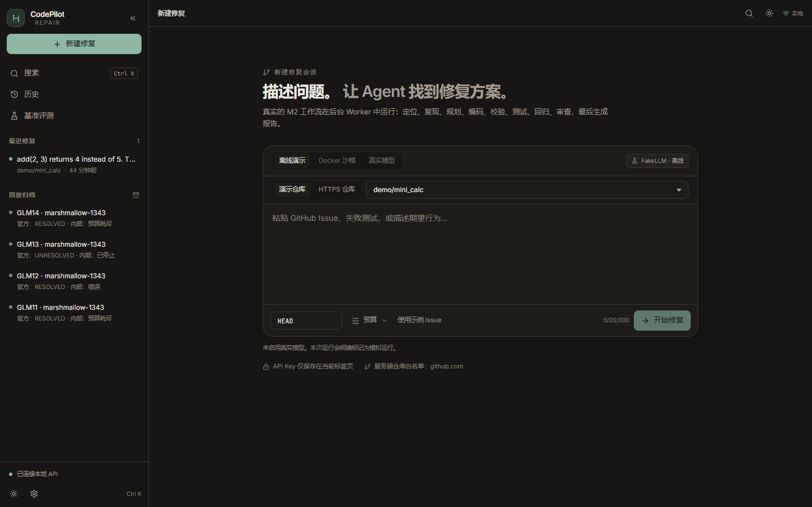
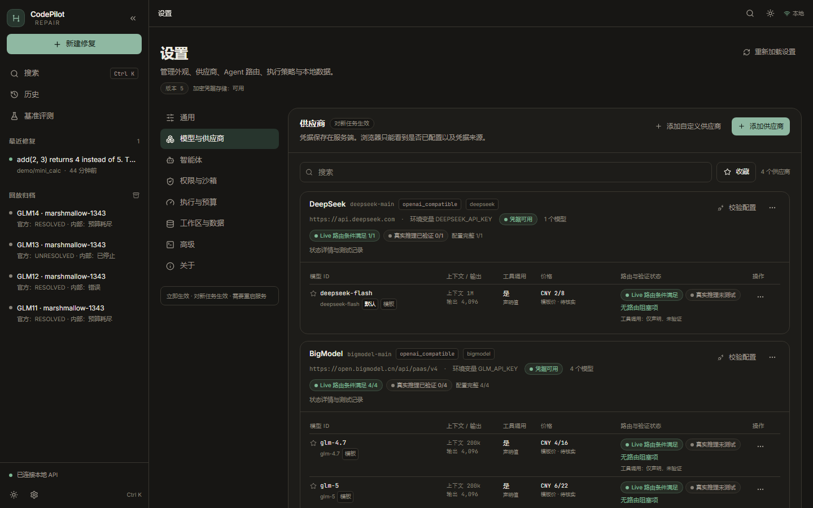
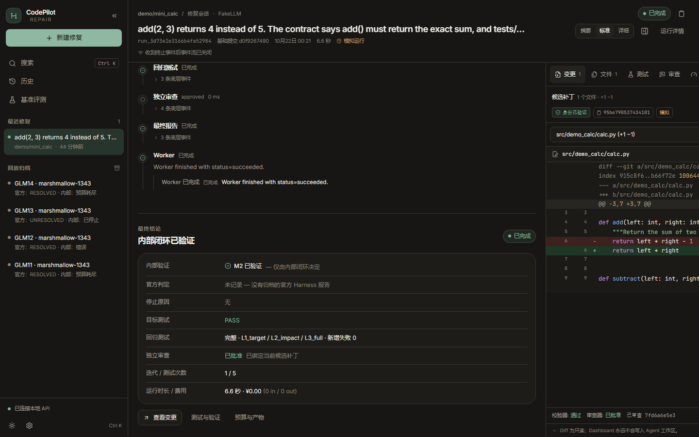
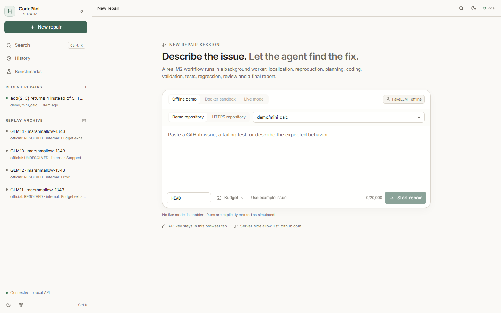
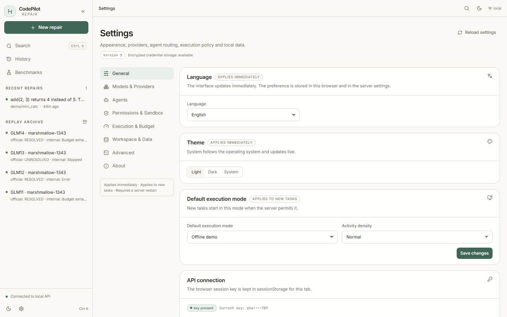
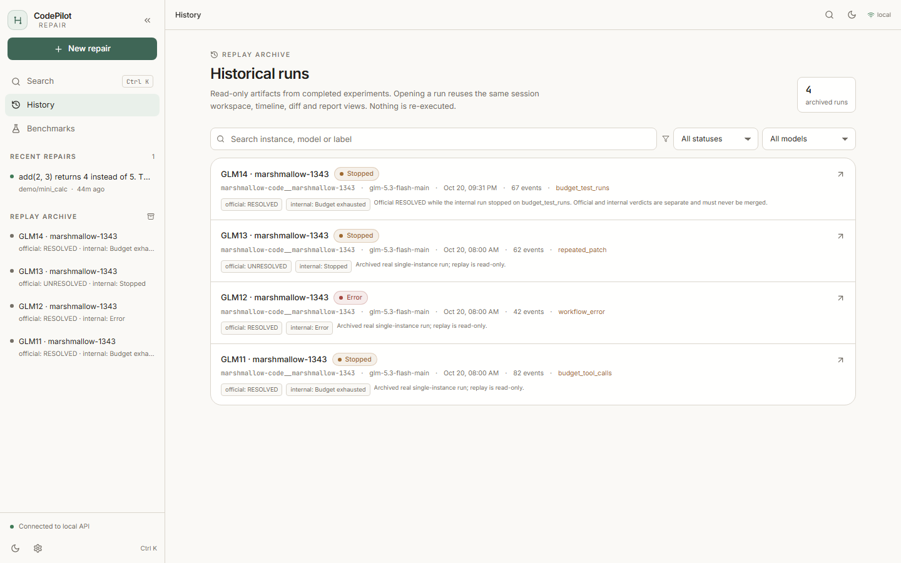
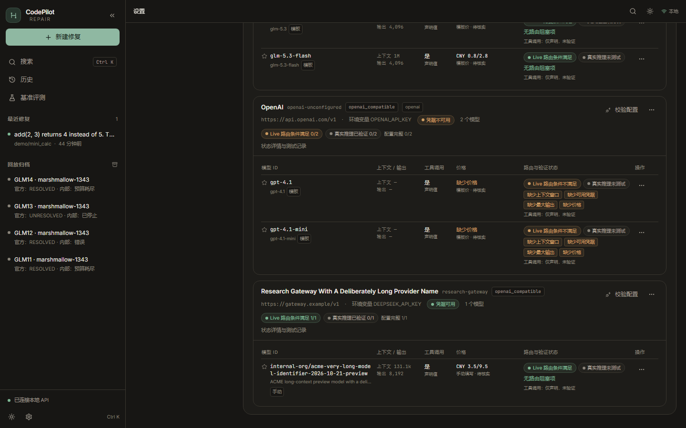
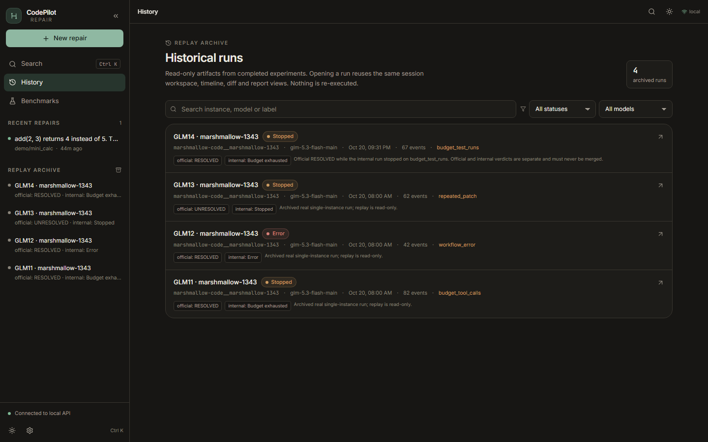

# CodePilot-Repair

**可配置、可回放、能真正运行的仓库级自主修复 Agent 工作台。**

给定一个 Python 仓库、一个固定 commit 和一份 Issue，CodePilot-Repair 在隔离环境中完成
**定位 → 计划 → 修改 → 测试 → 失败诊断 → 迭代修复 → 回归 → 独立审查**，输出补丁、
预算账本和可回放的运行记录。Phase 14 在此基础上补齐了完整设置中心、多供应商模型接入、
中英双语、明暗主题与 Docker Compose 部署。

> 当前定位是**单用户、本地/受信网络**的工作台，不是多租户生产系统。
> 沙箱、Docker socket 与 Provider 凭据的信任边界见 [`docs/06-security.md`](docs/06-security.md)。

## 发布状态与参与

当前按 **research / engineering preview** 准备发布，不承诺生产可用性。
Phase 37 已补充 Chromium 浏览器验收、真实 GLM SSE 流式验收（完成/中断/超时）
与 SDK 目录构建防护；24h 长稳、干净环境安装及其他真实 provider 结果应以对应
发布版本的证据为准。历史报告中的通过项不代表当前源码、所有平台或供应商均已
验证；当前候选的全量离线回归与 Docker 已分别记录，其中全量离线有一次
Windows 超时用例抖动并在隔离重跑中通过。候选提交的 Linux CI 六个 job 与依赖审计
均通过（见[发布清单](docs/open-source-readiness.md)与 [Phase37 报告](docs/notes/phase37-validation.md)），
最终文档提交的 CI 结果以该提交的发布记录为准；本版仍按 research /
engineering preview 发布，不称为稳定版或生产可用。

项目自有代码采用 [Apache License 2.0](LICENSE)，允许商业使用、修改和分发，须遵守许可证条件。
Copyright 2026 jiaoenqi。署名见 [NOTICE](NOTICE)。
第三方内容遵循各自的许可证，须保留随附的来源及许可声明。
第三方来源及依赖许可见 [第三方声明](docs/third-party/README.md)。
发布前检查见 [开源准备清单](docs/open-source-readiness.md)；
本轮审查结果与未验证范围见 [开源审查报告](docs/open-source-audit.md)。
浏览器验收、GLM SSE 流式探针及构建上下文防护的最新证据见
[Phase37 验证报告](docs/notes/phase37-validation.md)。
安全问题见 [SECURITY.md](SECURITY.md)，参与开发见 [CONTRIBUTING.md](CONTRIBUTING.md)，
社区规范见 [CODE_OF_CONDUCT.md](CODE_OF_CONDUCT.md)。

## 截图

| 新建任务（中文 · 黑暗） | 设置中心 · 供应商管理（中文 · 黑暗） |
|---|---|
|  |  |

| 运行时间线（中文 · 黑暗） | 新建任务（英文 · 明亮） |
|---|---|
|  |  |

| 通用设置（英文 · 明亮） | 历史回放（英文 · 明亮） |
|---|---|
|  |  |

| 长名称与窄桌面（中文 · 黑暗） | System 主题跟随系统（英文） |
|---|---|
|  |  |

截图为真实 Chrome（headless，1440×900；窄桌面检查为 1100×800）访问本地 API 后捕获；
数据来自隔离的本地设置与离线演示任务，**没有真实推理验证记录**。截图脚本见
[`scripts/capture_phase15_screenshots.mjs`](scripts/capture_phase15_screenshots.mjs)。

## 核心能力

- **真实 M2 LangGraph**：API 只持久化任务；独立 Worker 执行完整图（定位、规划、编码、
  校验、目标测试、回归、审查、预算、Checkpoint）。Web 没有第二套“简化 Agent”。
- **多供应商**：OpenAI 兼容、Anthropic 原生 Messages、AWS Bedrock Converse（可选 boto3）；
  支持 OpenAI、Anthropic、DeepSeek、Z.AI、BigModel、Moonshot/Kimi、Qwen 及自定义端点。
- **Provider / Model 设置**：内置目录、自定义供应商、多模型、默认模型、收藏、远端发现、
  连接测试（配置校验 / 模型发现 / 真实推理三档严格区分）、角色级模型覆盖。
- **凭据安全**：模型 Key 永不下发浏览器；支持环境变量引用和 Fernet 加密凭据库；
  任务快照只保存引用，不保存明文。
- **国际化与主题**：简体中文 / English，Light / Dark / System，即时切换并持久化；
  所有主界面、弹窗、状态、表单与无障碍标签均有双语资源。
- **预算与费用**：Token、费用硬上限、测试次数、工具调用、Reviewer 配额、迭代与时长；
  Live 任务在入队前冻结配置，配置缺失或币种不可换算时 fail closed。
- **Fake / Live / Replay 明确分离**：离线演示明确标记；历史回放只读；Live 必须显式选择、
  设置费用硬上限，并由 Worker 在服务端调用模型。
- **一键部署**：`docker compose up --build` 启动 API + Worker + 静态前端，SQLite 持久化。

## 架构

```text
Browser (React 18 + Vite + Tailwind + i18next)
   │  X-API-Key（同源）
   ▼
FastAPI (auth / settings / tasks / SSE / static /app)
   │  durable INSERT (queued)
   ▼
SQLite queue + events + settings + audit
   ▲                         │ claim / heartbeat / cancel
   │                         ▼
   │                 codepilot worker (独立进程)
   │                         │
   │                         ▼
   │            InferenceAssembly → M2 LangGraph
   │            (nodes / budget / checkpoint / review)
   │                         │
   │            Settings snapshot → Provider Registry
   │            (OpenAI-compatible / Anthropic / Bedrock)
   │                         │
   └──────────── EventSink / ArtifactStore / Report
```

关键行为：

- API 进程不做 Graph、Git clone 或 Docker 执行；模型 Key 不进入 API 响应。
- 每个任务冻结 provider/model/protocol/角色路由/配置 hash/预算；修改设置只影响新任务。
- 取消在节点边界协作式生效，不杀 Docker daemon，不影响其他项目容器。
- Worker 通过心跳文件暴露健康状态；API 与 Worker 共享 `/data` 持久卷。

完整设计见 [`docs/02-实现方案.md`](docs/02-实现方案.md)；Phase 14 的组件与接口见
[`docs/notes/phase14-product-settings-delivery.md`](docs/notes/phase14-product-settings-delivery.md)。

## 快速开始（本地）

需要 Python 3.12、`uv`、Node.js 22.12+（22 系列）或 24 LTS。Docker 仅在需要真实沙箱时使用。

```bash
uv sync --extra dev
cp .env.example .env
# 在 .env 中至少设置：
#   CODEPILOT_API_KEY=<至少 16 字符的随机串>
#   DEEPSEEK_API_KEY=...（或通过设置中心配置其他供应商）

# 终端 1：API
uv run codepilot api          # http://127.0.0.1:8000

# 终端 2：Worker
uv run codepilot worker

# 终端 3：前端开发模式
cd web && npm install && npm run dev   # http://127.0.0.1:5173
```

构建后由 FastAPI 同源提供：

```bash
cd web && npm run build
# http://127.0.0.1:8000/app/
```

首次打开页面输入 `CODEPILOT_API_KEY`。它只保存在当前浏览器标签页的 `sessionStorage`，
不会嵌入构建产物或 artifact。

### 三种运行模式

| 模式 | 模型 | 沙箱 | 用途 |
|---|---|---|---|
| `offline_fake`（默认） | 脚本化 FakeLLM | 确定性 fake sandbox | 演示、UI/流程验证，明确标记为模拟 |
| `docker` | 脚本化 FakeLLM | DockerSandbox | 验证真实容器执行链，不产生模型费用 |
| `live` | 设置中心里配置的真实 Provider | DockerSandbox（必需） | 真实模型任务；需要费用硬上限 |

Live 任务只有同时满足以下条件才允许入队：

1. 服务端允许（`CODEPILOT_API_ALLOW_LIVE_LLM=true`）且使用 Docker 沙箱后端；
2. 用户显式选择 live，并提供正的费用硬上限；
3. 所选 Provider 已启用、凭据可用；
4. 所有路由模型的上下文、输出上限、工具能力与输入/输出价格完整；
5. 价格币种可换算到预算币种。

本阶段验收使用 MockTransport / FakeLLM，没有调用付费 API，也没有运行真实 SWE-bench 批跑。

## Docker Compose 一键部署

```bash
cp .env.example .env
# 至少填写 CODEPILOT_API_KEY
# 可选：DOCKER_GID=$(stat -c '%g' /var/run/docker.sock)

docker compose up --build
# Dashboard: http://127.0.0.1:8000/app/
```

- API 与 Worker 使用同一镜像、同一持久卷 `/data`，SQLite 队列与 artifact 在重启后保留。
- 前端由 FastAPI 从 `/app` 同源提供，不额外暴露 nginx。
- 默认只绑定 `127.0.0.1`；API/Worker 都有健康检查。
- Worker 与 API 挂载 Docker socket 以使用 `DockerSandbox` / 做连通性诊断。
  **Docker socket 等价于宿主高权限接口**，不要把该栈暴露到公网；详见安全文档。
- Compose 只管理本项目资源：项目名 `codepilot-repair`，卷名
  `codepilot-repair-phase14-data`。清理时只应执行
  `docker compose -p codepilot-repair down`（需要连数据一起删除时才加 `-v`）。

## 多供应商模型配置

进入 **Settings → Models & Providers**：

1. **Add Provider** 从内置目录选择模板（自动填入协议、Base URL、建议模型与来源版本）；
2. 或 **Add custom provider** 填写名称、ID、协议、HTTPS Base URL；
3. 在 **Credential** 中对单个 Provider 保存加密 Key，或改用环境变量引用（如 `DEEPSEEK_API_KEY`）；
4. 手动添加/编辑模型，设置上下文、输出上限、工具调用、JSON、思考能力、价格与币种；
5. 点击 **Check configuration**（完全本地）、**Discover models**（主动请求目录）或
   **Test inference**（一次极小请求，需确认费用）；
6. 在 **Agents** 设置全局默认模型和各角色覆盖；任务级模型选择优先级最高。

内置目录中缺少可信规格的模型会明确显示为不完整，不会编造上下文窗口或价格。
AWS Bedrock 使用 AWS SDK 凭据链（environment / profile / instance role），不以 API Key
冒充 IAM；未安装可选 `bedrock` 依赖时目录会标为不可用。

### 内置协议支持

| 供应商 | 协议 | 状态 |
|---|---|---|
| OpenAI | OpenAI Chat Completions | 模板与适配器可用；模型规格需自行核实 |
| Anthropic | 原生 Messages API | 已实现请求/响应/工具调用与成本映射 |
| DeepSeek / BigModel / Z.AI / Moonshot / Qwen | OpenAI 兼容 | 可用；已验证规格来自 `configs/llm.yaml` 的既有配置 |
| AWS Bedrock | Converse API | 代码路径与确定性 Mock 测试已实现；需安装 `boto3` 才能启用 |
| Custom | OpenAI 兼容 / Anthropic Messages | 可用；受 HTTPS + SSRF 策略约束 |

## 国际化与主题

- 支持 `zh-CN`、`en-US`；默认跟随浏览器，不支持的语言回退到英文；可在 Settings → General
  中切换，切换即时生效并持久化到浏览器与服务端设置。
- 支持 Light / Dark / System；System 跟随操作系统并实时变化；首屏内联脚本避免主题闪烁。
- 界面文案集中在 `web/src/locales/zh-CN/` 与 `en-US/`；测试检查键集合、占位符、
  非法硬编码和语言切换。
- 状态枚举保留后端原值，展示层翻译；Issue、Patch、日志、模型输出不翻译。

## 真实实验证据（只读、不可重写）

历史基准来自 Phase 11–12 的真实单实例运行（`glm-5.3-flash-main`，marshmallow-1343）。
官方 SWE-bench verdict 与内部 M2 验证级别**独立记录**，不合并成一个成功率：

| 运行 | 官方 verdict | 内部终态 | stop reason | 内部 Usage（调用 / CNY） | 派发账本（调用 / CNY） |
|---|---|---|---|---|---|
| GLM14 | RESOLVED | budget_exhausted | budget_test_runs | 26 / 0.19581048 | 25 / 0.19192368 |
| GLM13 | UNRESOLVED | stopped | repeated_patch | 19 / 0.17084768 | 19 / 0.17084768 |
| GLM12 | RESOLVED | error | workflow_error | 13 / 0.12327760 | 13 / 0.12327760 |
| GLM11 | RESOLVED | budget_exhausted | budget_tool_calls | 45 / 0.28167776 | 45 / 0.28167776 |

GLM14 的两组数字**都是真实历史读数，来源不同，均保留**：

- **内部 Usage**（`run-artifacts/usage/*.json`，26 次 / 0.19581048）把 Reviewer 同一次响应
  记了两次：`by_role` 中 `reviewer` 与 `review` 各 1 次且金额相同；`events.jsonl` 的
  `seq=44`（node=`reviewer`）与 `seq=45`（node=`review`）时间戳、耗时、token 完全相同，
  call_id 不同。多出的 0.0038868 正好等于这一次审查费用。
- **派发账本**（`run-artifacts/dispatch-ledger.json`，25 条全部 settled，合计 0.19192368）
  记录的是实际 HTTP 派发，是真实请求次数的口径。
- 根因是 Reviewer 在装饰器链上被套了两层统计；修复提交 `a1afbaf` 的
  `tracks_usage` 改为沿 `inner` 按账本对象查重，并有
  `tests/unit/llm/test_tracking_chain_accounting.py` 回归测试。GLM11–GLM13 的两组数字原本
  就一致。历史 artifact 未重算、未改写。

这些是 **4 次单题运行**，不是 4 个不同实例，也不能据此推导 SWE-bench 解决率。原始 artifact
位于 `artifacts/phase11-glm1{1,2,3,4}-20261020/`，由 `configs/benchmarks.yaml` 只读登记；
Dashboard 回放不会重新执行或改写它们。

Phase 12 的 779 条基线回归验证（25 项判据、0 次模型调用、0 条新增残留）属于内部回归证据，
不是官方 SWE-bench 批量结果。M3 正式 SWE-bench、M4 消融、test50/test300、10 题费用校准与
真实 GitHub Actions CI **仍未完成**，不会因 Phase 14 产品界面完成而自动标记完成。

## 设置与安全摘要

- 设置文档带版本号与乐观并发控制；冲突返回 409，不静默覆盖。
- 所有 Settings API 都要求 `X-API-Key`，写入 `settings_audit`（不含密钥）。
- 模型 Key 只存环境变量引用或 Fernet 密文；API 只返回脱敏元数据；导出不包含明文；
  导入拒绝 Vault 引用，要求重新录入。
- 自定义端点强制 HTTPS、禁止重定向、禁用环境代理、验证并固定 DNS 解析结果到公网 IP，
  同时保留 `Host`/SNI；连接测试有超时与响应大小上限。
- 清理只删除已完成的用户任务及其 run artifact，必须输入 `DELETE`；历史 benchmark 与运行中
  任务不在删除范围。
- 沙箱覆盖仓库测试执行与工作区路径边界，但不等于对抗恶意代码或多租户隔离的生产边界。

完整威胁模型见 [`docs/06-security.md`](docs/06-security.md)。

## 测试与门禁

```bash
uv run ruff check .
uv run ruff format --check .
uv run mypy src
uv run pytest -m "not docker and not llm" --cov --cov-report=term

cd web
npm test
npm run lint
npm run typecheck
npm run build
```

Phase 14 新增测试覆盖：设置版本冲突、凭据不可回读与密文落盘、导入导出、角色路由优先级、
Live 入队 fail-closed、MockTransport 下多 Provider 进入现有 Graph、Anthropic/Bedrock 适配器、
SSRF 负控制、i18n 完整性、语言切换、主题 System 响应与设置中心交互。具体通过数字记录在
[`docs/notes/phase14-product-settings-delivery.md`](docs/notes/phase14-product-settings-delivery.md)。

Phase 13 的 Linux 门禁为 6 skipped，Phase 14 为 8 skipped。新增的两项都是**显式的环境依赖**，
不是被屏蔽的失败：

| 测试 | 跳过条件 | 说明 |
|---|---|---|
| `tests/unit/retrieval/test_semantic_backends.py::test_real_faiss_if_installed` | 可选 `faiss` 未安装 | 其余 FAISS 回退路径仍用 monkeypatch 正常运行；安装 optional extra 后该测试会执行 |
| `tests/api/test_phase13_history.py::test_real_glm14_artifact_replay_keeps_verdicts_separate` | 当前树没有 `artifacts/phase11-glm14-20261020/run-artifacts` | Phase 14 的 WSL 同步树未带历史 artifact；当前 Windows 工作树中该测试**实际执行并通过** |

其余 6 项为 Windows 专属 junction/taskkill 用例与未设置 embedding 模型的既有 skip。
Phase 15 没有新增无理由 skip、没有降低覆盖率阈值。定向结果见
[`docs/notes/phase15-engineering-hardening.md`](docs/notes/phase15-engineering-hardening.md)。

## Phase 16–18 摘要

- Phase 16 完成一次真实推理与 Live M2 全链路（32 次调用，CNY 0.205089），但官方镜像的
  NumPy/PyTables ABI 问题使官方判分记为 `INVALID_ENV`；原记录未被改写。
- Phase 17 定位并修复该镜像问题，用 Phase 16 原预测/补丁完成有效官方 Harness 评测，verdict
  为 `RESOLVED / VALID_EVAL`，模型费用 CNY 0.00。
- Phase 18 完成生产组件级内部 M2 环境恢复（零模型费用），并在 L2-Cal10 真实执行 7/10：
  有效官方评测 5、RESOLVED 2、有效官方解决率 40.0%；内部链路形成终态 3/10，内部声称成功
  1/10。`pydata__xarray-4493` 因 `ReadTimeout` 未知费用冻结账本后停批，后 3 题未执行。
  费用记账上界 CNY 1.868388（已结算 1.056919 + 未知预留 0.811469），对账按保守上界完成，
  实际用量未知。详见
  [`docs/notes/phase18-m2-environment-and-l2-cal10.md`](docs/notes/phase18-m2-environment-and-l2-cal10.md)。
- Phase 18E 追加 l2cal10e 至 `l2cal10e-a21`：pytest 子项仍为 **`NOT VERIFIED`**（内部验收
  `REJECTED`），pytest 官方 Harness **未运行**，官方状态只能是 `NOT_EVALUATED` / `DEFERRED`；
  sklearn 的既有内部 recheck 为 `ACCEPTED`、官方为 `UNRESOLVED`，本轮未重跑。pytest 累计
  上界 CNY 7.80709616，sklearn CNY 0.62403504，未知预留 CNY 4.05734400（5 次，绝不按零
  计费）；受保护哈希 12/12、registry 25/25 账本哈希一致。不得继续派发 a22 或任何新实时运行。

## 文档

| 文件 | 内容 |
|---|---|
| [`docs/02-实现方案.md`](docs/02-实现方案.md) | 架构与算法设计权威 |
| [`docs/03-AGENTS.md`](docs/03-AGENTS.md) | 工程与测试规范 |
| [`docs/04-分阶段开发任务清单.md`](docs/04-分阶段开发任务清单.md) | Phase 0–14 任务与验收 |
| [`docs/05-精细化待办清单.md`](docs/05-精细化待办清单.md) | 细分任务与依赖 |
| [`docs/06-security.md`](docs/06-security.md) | 凭据、SSRF、沙箱、Docker socket、单用户边界 |
| [`docs/notes/phase14-product-settings-delivery.md`](docs/notes/phase14-product-settings-delivery.md) | Phase 14 交付、API、验证证据与未完成项 |
| [`docs/notes/phase15-engineering-hardening.md`](docs/notes/phase15-engineering-hardening.md) | Phase 15 基线、费用口径、UI、测试与预检记录 |
| [`docs/notes/phase15-m3-execution-plan.md`](docs/notes/phase15-m3-execution-plan.md) | M3 分层评测计划、预算、归档与去重条件 |
| [`docs/project-summary.md`](docs/project-summary.md) | 工程架构、技术难点、测试质量与真实评测总结 |
| [`docs/demo/phase14-demo-script.md`](docs/demo/phase14-demo-script.md) | 约 3 分钟演示脚本 |
| [`docs/llm-config.md`](docs/llm-config.md) | 已核实模型/价格来源与真实冒烟记录 |

## 已知限制

- 单用户、单机、SQLite 队列与单 Worker；无多租户、RBAC、配额或分布式调度。
- Docker socket 暴露给 API/Worker；本栈默认只绑定回环地址。
- 内置 Provider 模板中的模型 ID 与价格需要用户核实；目录不会假装拥有实时价格。
- 「Live 路由条件满足」只代表配置/凭据/价格/预算准入通过；当前界面没有任何真实推理验证
  记录，因此统一显示「真实推理未测试」。连接测试结果只保存在本机设置库，并带配置指纹；
  模型或凭据引用改变后旧结果标为「验证已过期」。
- Bedrock 需要可选 `boto3` 依赖；未安装时标为不可用。
- Live 任务仍要求 Docker 沙箱；测试用的 simulated-sandbox 逃生门默认关闭且不应在生产启用。
- 付费调用与官方 SWE-bench 批跑已按阶段单独授权执行（Phase 16–18）；40% 只是 5 个有效官方
  评测的读数，不是 test50/test300/M4 结论。当前仍未执行 test50/test300/M4 与消融。
- 演示视频未在本环境录制（见演示脚本中的 NOT RUN 声明）；截图为真实浏览器生成。
- SSE 流式能力是 OpenAI 兼容 Provider 的可选入口，当前验证覆盖 BigModel
  `glm-5.3-flash` 及本地 TCP 夹具；原生 Anthropic/Bedrock 流式协议和浏览器端
  逐 token 渲染尚未验收。Spark 未配置价格，历史真实调用的实际费用保持未知。
- 当前检出为 shallow 仓库；全历史 clone 未验证。发布候选只沿用项目分支的
  现有历史，不推送本地异常 `main` 或全部 refs。
