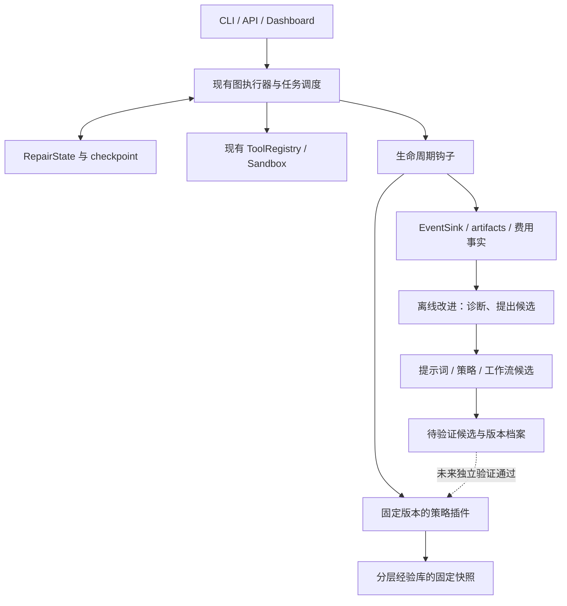

# CodePilot-Repair 下一阶段改进方案：性能、修复能力与可回溯 RSI

> **前置声明**：本阶段暂不运行 test50、耗时测试、Docker 实验、官方 Harness 或真实模型调用。本文件是基于当前代码静态核查、历史运行证据与公开资料制定的执行设计，不是性能提升报告。所有尚未实际运行验证的改进统一标为 **“待验证”**；不能以设计合理、静态检查通过或历史成功案例代替运行验证。
>
> 基线：`07625a8`；日期：2026-10-28。项目根目录：`D:/Projects/Desktop/CodePilot-Repair`。研究范围为 CodePilot-Repair2 对话对应的当前仓库。历史结果、原始账本与未知费用均保留，不启动新付费工作。

> **实施更新（2026-10-28）**：本轮已形成源码、测试代码和静态检查产物。最新实施状态见第 15 节及 [Phase26 实施报告](phase26-implementation.md)。运行效果仍全部待验证；第 14 节保留的是方案编制时记录。

## 1. 六大优化目标

| 目标 | 用户可感知结果 | 建议观测指标 | 当前依据与目标状态 |
| --- | --- | --- | --- |
| 准备速度 | 重复任务不重复下载、建环境、全量索引 | 冷/热启动时间、各缓存命中率、增量文件数、准备阶段耗时 | 历史 Django 索引约 433/1022 秒；减少重复准备的效果**待验证** |
| 行动效率 | 少反复搜索，定位后及时形成补丁 | 首次有效修改时间、重复查询率、只读调用占比、无补丁率 | Django-16816 的 Coder 30 次调用均只读；改进效果**待验证** |
| 修复质量 | 交付行为与需求一致，不是仅通过自己写的探测 | 契约覆盖、真实功能失败率、候选引入回归率 | 历史 Sphinx/Matplotlib 的实现与自测共同偏离契约；改进效果**待验证** |
| 验证效率 | 必要验证不遗漏，相同证据不重复生产 | 重复测试时间、验证范围、超时率、证据复用率 | Django-14999 相同候选补验 614 项通过；正式路径优化**待验证** |
| 恢复能力 | 中断后从有效阶段继续，不重复付费 | 恢复成功率、重放阶段数、重复副作用数、恢复耗时 | 已有 checkpoint 与阶段恢复；统一正式入口的效果**待验证** |
| 产品体验 | 能看到当前工作、等待原因，并取消和恢复 | 阶段可见性、状态延迟、取消确认耗时、恢复可解释性 | 已有事件流与取消检查；端到端体验尚未在本阶段验证 |

不预设“提速两倍”“解决率提升若干百分点”。先统一指标定义，再由未来同条件比较形成结论。成功率、时间、成本共同衡量，不能靠增加调用和时间预算制造表面进步。

## 2. 当前痛点与代码事实

### 2.1 已有事实

- Phase25 首组真实派发 5/5，合法候选官方判分 4/4，结果为 3 RESOLVED、1 UNRESOLVED、1 NO_PATCH；三道历史调试题另计，不能用于独立泛化结论。
- 内部 ACCEPTED 不保证官方成功；内部拒绝也不意味着补丁错误。不得继续用单一验收布尔值概括全部证据。
- 回归超时曾被错误归因为 collection error；`45298a3` 已修复 Django/SymPy 原生解析的超时优先归因，本阶段不把它重复列为未修复缺陷。
- `RepairState`、`Attempt` 已存在，事件通过 `EventSink` 写入 JSONL 和事件存储；API worker 已有取消检查与 checkpoint 接入。共享状态、取消恢复属于整合优化，不是从零实现。
- `ToolRegistry` 已提供角色化工具注册；已有搜索回退、响应缓存、环境缓存和阶段恢复，不能再建立功能重复的平行系统。

### 2.2 本次静态确认的一个直接缺口

`scripts/m3_batch.py` 的直接官方执行分支在读取结果后先设置 `terminal=True`，随后才检查 verdict 和返回码。文件存在但结果无效时，实例可能被后续循环跳过。

修复原则：结果可信且 verdict 为 RESOLVED/UNRESOLVED 时才完成；无效结果保持官方恢复入口。若非零退出但已有可信最终判分，保留判分并记录进程异常，不机械重复评测。该修复和恢复行为均**待验证**。

### 2.3 优先接入位置

| 现有位置 | 复用职责 | 建议改动 |
| --- | --- | --- |
| `src/codepilot/schemas/state.py` | 任务/候选/证据状态 | 仅增带默认值的可选字段，不改历史字段语义 |
| `src/codepilot/observability/events.py` | 事件与回放 | 扩展生命周期事件及来源信息，兼容历史事件 |
| `src/codepilot/tools/registry.py` | 工具执行入口 | 添加轻量前后钩子、请求归一化与去重接缝 |
| `src/codepilot/tools/read_tools.py` | 文件读取、搜索回退 | 内容身份缓存、范围收敛、结果差量 |
| `src/codepilot/agents/coder.py` | 工具循环与修复 | 回合级探索进展反馈、契约与失败摘要 |
| `src/codepilot/agents/reviewer.py` | 独立审查 | 对照契约和证据，保留完整补丁上下文 |
| `src/codepilot/graph/stage_recovery.py`、`checkpoint.py` | 阶段导入和恢复 | 统一恢复入口，减少临时恢复脚本依赖 |
| `src/codepilot/graph/stop_rules.py`、`progress.py` | 轮次级停止判断 | 保留现有停止依据，不用它代替回合级探索监测 |
| `src/codepilot/api/worker.py` | 执行、取消、状态汇总 | 展示同一状态来源，贯通取消与恢复 |
| `scripts/m3_batch.py` | 批次隔离与官方恢复 | 修复终态遗漏，复用合法候选 |

## 3. 前沿架构与研究：采用什么，不照搬什么

AI Agent 相关重要成果常发表在顶会而非期刊。本方案区分已核实的顶会论文、预印本和产品工程实践，不将它们统称为“顶刊成果”；论文报告的收益不视为本项目收益。

| 来源 | 可核实的机制 | 本项目采用方式 | 不照搬的部分 |
| --- | --- | --- | --- |
| Pi：极简、可扩展 Agent Harness | 核心工具与扩展分离；工具执行和会话具有生命周期接缝 | 保持读、查、改、执行、完成的小型稳定工具面，特殊策略作为可替换组件 | 不强制缩减为四个工具；保留仓库符号能力，不以任意 shell 取代现有权限与工具语义 |
| DeepSeek Harness / Cordis | 插件组合与生命周期管理；客户端 HMR 支持局部重载 | 先将搜索策略、上下文选择、经验检索做成内部插件；版本切换与任务状态分离 | 不将客户端热更新解释为后端有状态对象能任意无损替换，不迁移整个项目到 TypeScript/Cordis |
| Claude Code Hooks | 在工具前后、会话和结束等事件执行确定性处理 | 建立少量有返回语义的前后钩子，收集事实、注入必要反馈 | 不为每个钩子调用模型，不让普通观察钩子变成新的审批流程 |
| SWE-agent，NeurIPS 2024 | Agent-computer interface 的设计影响操作能力 | 优化工具输入、输出、定位与编辑反馈，减少无效交互 | 不直接继承论文基准分数或替换现有编排 |
| GEPA，ICLR 2026 | 利用轨迹与文本反馈提出、筛选提示词候选 | 离线、少量候选、单因素比较，记录提示版本和适用条件 | 不立即引入昂贵自动进化搜索，不自动启动训练或评测 |
| ACE，预印本 | 通过生成、反思、整理增量积累上下文经验 | 将经验更新为条目差量，避免每轮重写全部系统提示 | 不把全部经验追加进每次请求 |
| A-MEM，论文/开源实现 | 结构化记忆及关联检索 | 为经验添加来源、作用域、关联与失效条件 | 初期不部署独立向量数据库或复杂知识图谱 |
| DGM，研究论文 | 保留 Agent 改进候选并以实验筛选 | 后期对工具/工作流提出代码候选，保留父子版本关系 | 本阶段不允许在线修改运行内核、预算、评测规则或改进器自身 |

资料入口：

- Pi：[官方仓库](https://github.com/earendil-works/pi)、[核心说明](https://github.com/earendil-works/pi/blob/main/packages/coding-agent/README.md)、[扩展接口](https://github.com/earendil-works/pi/blob/main/packages/coding-agent/docs/extensions.md)。
- DeepSeek：[官方仓库](https://github.com/deepseek-ai/deepseek-harness)、[插件管理](https://github.com/deepseek-ai/deepseek-harness/blob/master/packages/boot/plugin-manager/README.md)、[客户端 HMR](https://github.com/deepseek-ai/deepseek-harness/blob/master/packages/client/hmr/README.md)。HMR 文档明确说明组件局部状态会重建，不能声称任意插件状态无损保留。
- Claude Code：[官方 Hooks 文档](https://code.claude.com/docs/en/hooks)。
- SWE-agent：[NeurIPS 2024 正式论文](https://proceedings.neurips.cc/paper_files/paper/2024/hash/5a7c947568c1b1328ccc5230172e1e7c-Abstract-Conference.html)、[开源实现](https://github.com/SWE-agent/SWE-agent)。
- GEPA：[ICLR 2026 正式论文](https://proceedings.iclr.cc/paper_files/paper/2026/hash/0e9e708b6f48e14fd0ac29e167413f76-Abstract-Conference.html)、[官方实现](https://github.com/gepa-ai/gepa)。
- ACE：[论文](https://arxiv.org/abs/2510.04618)。本轮未核实作者对应代码仓库，不列未确认地址。
- A-MEM：[论文](https://arxiv.org/abs/2502.12110)、[作者项目实现](https://github.com/agiresearch/A-mem)。
- DGM：[论文](https://arxiv.org/abs/2505.22954)。

## 4. 目标架构：一个共享状态，小型插件，明确执行边界



### 4.1 共享状态层

- `RepairState` 是运行状态权威来源；插件通过只读视图获取必要事实，返回结构化建议或补丁，由图节点统一应用。
- 不允许多个插件直接并发修改同一 Pydantic 状态。提交状态更新时绑定预期 revision；冲突由执行器重读处理。
- `Attempt` 继续保存每轮修复事实；增加的契约、探索反馈、策略版本等字段必须可选且有默认值。
- 事件是过程事实与回放入口，checkpoint 是可恢复快照；不能只靠一串事件假设可以重建所有外部副作用。
- 费用以账本为准，不能通过事件回放再次结算；UI 状态不是第二个账本。
- 插件私有状态限临时缓存。影响后续决策的状态必须进入现有 checkpoint 或受引用的 artifact。

### 4.2 稳定核心与插件边界

稳定核心保留：任务身份、状态提交、工具执行、预算记账、取消、checkpoint、证据存取。先开放四类内部插件：搜索结果策略、上下文选择、探索进展反馈、经验检索。使用 Python `Protocol` 与显式注册表即可，不建设插件商城、独立服务总线或通用依赖安装器。

插件描述最少包含：名称、版本、内容哈希、输入输出契约、允许钩子、所需只读状态和释放资源函数。新增功能先以内部组件落地，确有第二种实现时再抽象公共协议。

### 4.3 有边界的热重载

1. 提示词/经验/策略文件先加载为候选快照，完成静态兼容检查。
2. 新任务默认绑定一份固定快照；当前工具调用、模型请求、测试进程执行期间不切换。
3. 开发模式允许在节点结束、无活动副作用的边界切换，记录旧/新版本和切换原因；正式评测始终固定。
4. 原插件先停止接收新工作，等待在途调用完成或取消，再释放资源、替换引用。
5. 加载失败继续使用旧快照并报告原因；回滚本地策略不等于撤销模型费用或外部操作。
6. Python 代码插件首版采用受控 worker 重启，恢复 checkpoint；不依赖 `importlib.reload` 来保证任意对象、线程和闭包安全更新。

插件切换、事件记录和恢复开销均**待验证**。

## 5. 性能方案

### 5.1 统一缓存与恢复路径

不建立新的总缓存服务。先为现有缓存统一身份描述、命中理由和失效说明，再由正式入口调用：

| 缓存对象 | 必要身份 | 失效方式 |
| --- | --- | --- |
| Git 对象/工作区 | 规范 source、base、workspace revision | source/base 变化；脏工作区不能冒充 base |
| 仓库索引 | 文件内容、解析器版本、符号/依赖构建配置 | 文件内容变化触发局部解析；导入变化需更新受影响关联 |
| 环境与编译产物 | 镜像 digest、平台、依赖/构建配置 | 镜像或依赖变化；Python ABI 不同不能复用 `.so` |
| 搜索/读取 | workspace 内容 revision、参数、权限范围、工具版本 | 编辑后相关结果失效；新增文件必须使相关负缓存失效 |
| 测试证据 | base/候选、环境、runner、selector 集合与顺序、配置 | 任一身份变化；超时/部分执行不得作为完整通过缓存 |
| 模型响应 | 完整请求、模型/provider、工具定义、策略及经验版本 | 请求或上下文改变；只复用现有已结算、可追溯响应 |

正式恢复顺序：读取 checkpoint → 判断工作区与副作用状态 → 确认候选与有效证据 → 从最早失效阶段继续。已有合法候选且仅官方调用失败，直接恢复评测，不重新运行 Coder。

索引以文件内容复用为基础，跨文件导入/调用/test-link 重建按依赖影响扩展；不能只更新改动文件就宣称整个图正确。阶段产物优先内容引用，跨磁盘迁移只修改新引用，不改写历史原始记录。

### 5.2 搜索收敛与去重

- 参数归一化保留大小写、regex、glob、目录和结果上限语义，不对不同搜索误判等价。
- 先查已定位符号与文件，再查相邻模块，最后扩大仓库范围；允许模型说明必要性后扩大，而不是硬锁目录。
- 相同输入、相同 revision 的只读查询直接返回缓存，注明复用来源；费用和工具调用统计分别反映实际执行与逻辑调用。
- 读取缓存按文件内容和行区间复用，展示新增区间；符号不存在、空结果和截断结果必须明确区分。
- 大结果采用命中摘要、路径/行号、可继续读取游标；不得裁掉与失败相关的异常和事实。
- 去重只适用于无副作用且环境确定的工具。模型调用、写文件和网络操作不使用简单去重自动重试。

### 5.3 分治资源竞争

调度器为下载、重型索引/构建、测试、模型请求分别维护轻量并发配额。首版不引入集群调度系统。

- 重型索引/构建按内存与磁盘压力限并发；同一 workspace 写操作串行。
- 下载保留已完成层；不能为节省等待反复中断下载。
- 测试与索引避免同时耗尽容器内存；模型等待期可推进独立的轻量准备。
- 资源不足先调整并发和阶段顺序，不扩大测试超时来掩盖资源争用。
- 记录排队、执行、外部等待三类时间；不能把排队时间全部算成 Agent 推理时间。

收益**待验证**：热任务准备时间、重复读取量、CPU 峰值和总墙钟时间。不得先写入提速百分比。

## 6. 能力方案

### 6.1 四项需求契约

复用 Planner 输出并提供给 Coder/Reviewer，不新增独立“契约 Agent”：

1. **需要改变的行为**：触发条件、输入与用户可观察输出。
2. **需要保留的行为**：默认行为、兼容性、异常和副作用边界。
3. **接口约定**：入口名称、参数、返回结构与版本语义，附公开来源。
4. **区分性验证**：能够区分 base 与正确行为的观察方式，预期独立于当前实现。

每项注明 `explicit / inferred / unknown` 和来源。未知点不自动阻塞：先查公开代码/需求，影响很小的采用项目惯例并记录；影响核心行为且无法推断时再询问用户。不得使用参考补丁或隐藏测试构造未见样本答案。

### 6.2 拦截无进展探索，但不禁止合理调查

现有 `ProgressSnapshot` 主要判断修复轮次与测试结果。新增的是 Coder 工具回合级观察，不替换原停止规则。

- 事实特征：重复查询、新增相关文件/符号、新证据、修复假设变化、已覆盖代码范围、当前 diff。
- “读取了新文件”不一定是有效进展；以其是否解释需求或失败为判断依据，保留低成本确定性特征与模型建议的区别。
- 首次重复：回用结果并提示已读位置。
- 持续低收益：注入短摘要，要求提出假设、说明缺口并选择下一步。
- 证据足够：转入最小修改；证据不足：允许一次有明确问题的范围扩展。
- 仍空转：保留现场，返回 Planner/诊断节点重定向，而不是静默耗尽额度。
- 不强制固定第 N 次必须写代码，不凭只读比例直接判失败，不自动增加硬额度。

阈值是初始设计参数，需未来用不同复杂度任务验证；当前全部**待验证**。

### 6.3 结构化失败摘要

沿用现有 execution/diagnosis 数据，统一向 Coder 提供以下视图：

```yaml
failure:
  stage: regression
  category: timeout          # product / environment / tool / provider / timeout
  observed: "执行范围未完成，保留部分结果"
  expected: "完成所选范围并记录逐项结果"
  evidence_refs: ["artifact://run/.../execution.json"]
  candidate_hash: "..."
  baseline_relation: unchanged_or_unknown
  scope: {requested: 614, observed: 228, missing: 386}
  new_since_last_attempt: "本次确认是超时，未发现新增断言失败"
  suggested_next_action: "复用有效结果，核实环境与时间后补齐剩余验证"
```

示例数值来自历史情形，不代表新执行。建议动作是建议，不是自动伪造通过；执行器仍按实际测试完整性判定。相同补丁再次失败时，要求明确新增证据和策略差异，避免原样重试。

## 7. 验证方案：三层证据与布尔值分离

### 7.1 三层证据推导

| 层次 | 要回答的问题 | 证据来源 | 完整性要求 |
| --- | --- | --- | --- |
| 需求行为 | 是否修复声明的行为？ | 公开需求、区分性复现、实际输出 | 预期不能由候选实现反推；保留 base 对照 |
| 受影响回归 | 是否破坏相关既有行为？ | 影响范围、基线、逐测试结果 | 保留 selector 真实收集顺序和基线失败 |
| 扩大验证 | 还存在多大不确定范围？ | 包级/仓库级选择与运行 | 报告已覆盖、未执行、超时、skip 与 flaky |

验证是由证据推出结论，不是“每层都跑越多越好”。先根据风险和范围提出计划，已有完整同身份证据直接引用；范围扩大后补差量，不能把缺失节点视为通过。

### 7.2 分离结果、执行与可信度

对外展示以下独立维度，原 acceptance 兼容字段可以保留但不再承担全部语义：

- `execution`：未执行 / 完成 / 超时 / 环境错误。
- `behavior`：满足 / 不满足 / 未知。
- `regression`：干净 / 新失败 / 未完整测量。
- `review`：未审查 / 同意 / 反对，绑定候选。
- `coverage`：目标、实际观察与缺失范围。
- `official`：NOT_EVALUATED / RESOLVED / UNRESOLVED / ERROR。

这些是展示与判定维度，不要求新增六套状态机。内部拒绝时合法候选仍可按既有规则独立评测；官方 ERROR 不是 UNRESOLVED。skip 不是 PASS，是否阻碍契约验证取决于它覆盖的行为。

### 7.3 验证时间分配

利用同环境基线耗时、范围大小和既有超时记录估算单次时间，留出修复与 Review 空间。没有基线时使用明确保守默认并记录不确定性。资源排队与真实执行分开计时；不能把 600 秒只写在补验脚本中而正式 runner 仍采用旧值。

本阶段只设计上述策略；运行效果、误拒绝率和验证时间收益均**待验证**。

## 8. 可靠性方案：修已核实缺口，用现有状态驱动

### 8.1 当前优先事项

1. 修复官方无效结果被标为终态的遗漏。
2. 核对正式 runner 的 effective timeout 和配置来源，避免独立脚本与主入口偏离；是否还有遗漏以最新代码为准。
3. 将通用恢复能力接回主入口，历史脚本继续保留。
4. 保持实例异常隔离与批次级预算约束，不回退为任一 error 停止全部任务。

不将未经核实的推测列为 P0，不借此次优化重写全部 checkpoint 或事件存储。

### 8.2 恢复决策

- 无模型/外部副作用的准备失败：修复环境后重试准备。
- 已有已结算响应/阶段产物：身份一致时复用；上下文变化则生成新来源段。
- 已有候选、验证中断：保留候选，重做失效或缺失验证，不重新生成补丁。
- Harness 异常：复用相同 prediction 恢复评测。
- Provider usage 不确定：保存 unknown，不自动重发同请求；未来执行按当时授权和总费用上界决定继续方式。

重试都有次数/资源上界和策略变化记录，但一次失败不结束整个任务。恢复先核对进程状态；无法确认旧进程停止时不并发重放有副作用阶段。

## 9. 产品体验方案

复用 API worker、现有事件和 Dashboard 数据流，不另建轮询数据库：

- 展示准备、索引、定位、修改、验证、审查、交付阶段；标注排队、执行、外部等待。
- 每阶段显示开始时间、累计时间、最近有效进展、缓存命中和当前候选状态。
- “正在搜索”进一步解释为搜索范围、是否有新增证据；不能只展示调用计数。
- 无可靠完成模型时不展示虚构百分比/ETA；展示阶段及已完成范围即可。
- 取消区分已请求、正在结束在途操作、已取消。保留当前 patch、checkpoint、费用与未完成操作。
- 模型请求取消未收到 usage 时按未知处理；不能因为前端断开就认定请求未收费。
- 恢复前展示将复用哪些阶段、重新执行哪些阶段及原因。
- 配置页面展示“期望值 / 当前任务实际值 / 下次任务生效值”；热重载失败展示仍使用哪个版本。

现有取消与恢复已具备部分基础；本阶段重点是贯通和解释，而非宣称首次实现。交互和取消延迟改善**待验证**。

## 10. 生命周期钩子设计

钩子挂在真实调用入口，观察类默认不改变结果；同事件按固定顺序执行。首版不运行任意 shell hook、不调用第三方远程服务。

| 钩子 | 输入事实 | 允许产物 | 失败处理 |
| --- | --- | --- | --- |
| task_start | 固定配置、任务身份 | 经验快照引用、阶段计时 | 经验不可用则无经验继续 |
| before_model | 契约、近期证据、上下文预算 | 有界上下文、提示来源清单 | 回退上一可用上下文构造 |
| before_tool | 参数、workspace revision | 只读缓存命中、参数错误反馈 | 工具权限和费用控制仍由核心负责 |
| after_tool | 实际结果、耗时、修改范围 | 缓存失效、探索进展、失败摘要 | 观察钩子异常记录后继续 |
| candidate_changed | patch 身份、改动文件 | 失效相关验证证据 | 身份更新失败不能冒充原候选有效 |
| after_validation | 实际执行与范围 | 三层证据视图、下一步建议 | 缺少摘要时保留原始结果 |
| checkpoint_saved | 状态 revision、artifact 引用 | 回放定位点 | 不重复写入副作用 |
| cancel/resume | 当前阶段、在途操作 | 取消确认与恢复计划 | 交还现有执行器决策 |
| task_end | 结果、成本与日志引用 | 离线经验候选 | 不拖延任务交付 |

事件信封在现有字段基础上按需增加：`event_id`、`causation_id`、`state_revision`、`policy_hash`、`plugin_hashes`、`experience_snapshot`。历史兼容以可选字段和默认值处理；不为所有小事件生成庞大 provenance 文档。

观察事件可以异步；改变执行顺序和上下文的钩子必须确定顺序。插件失败只隔离插件，预算和身份约束由稳定核心执行。没有已验证新版本时使用既有版本，避免优化组件变成主任务的新阻塞。

## 11. RSI：共享状态、钩子与分层经验库组成离线闭环

### 11.1 定位与阶段边界

首版是“可追溯的 Harness 自我改进辅助”，不是已证明的递归能力增长。它不训练模型权重，不在运行中改写执行内核，不修改自己的评分标准。只有未来证明新版本在独立任务上改善，才称有效自我改进；改进器自身变强还需另外证据。

本阶段不调用反思模型。可以静态整理历史经验和生成候选模板；所有生成、筛选、执行相关入口默认关闭，不消费旧模型预算。

### 11.2 四层经验库

| 层次 | 内容 | 作用域与更新 |
| --- | --- | --- |
| L0 工作记忆 | 当前事实、假设、最近失败、已读范围 | 单任务，进入 checkpoint，不跨项目直接复用 |
| L1 仓库经验 | 构建方法、runner 特性、目录/API 惯例 | 绑定仓库/版本/环境，代码变化后可失效 |
| L2 通用修复经验 | 防止无效探索、需求契约、常见失败处理 | 跨仓库候选，需要多样来源支持 |
| L3 元经验 | 哪类提示/策略修改在何种任务有效或退化 | 只从版本比较产生，不能由模型自评分直接提升 |

原始轨迹与经验分离：原始事件不覆盖，经验支持追加修订、合并和退役。初期用受版本管理的 JSON/Markdown 条目与现有检索能力，不引入独立向量服务。

经验最少记录：`id`、层级、适用条件、建议动作、反例/失效条件、证据引用、来源 run、版本、待验证/已验证状态、敏感性/评测接触标记。未经验证的模型归纳只能作为建议，不能包装成事实。

每次注入保存条目 ID、版本和实际文本快照。检索按任务匹配和证据有效性排序，只注入少量相关条目；允许拒用不适用经验，记录理由。过去建议有效不意味着未来永远适用。

### 11.3 每一轮改进的流程

```text
收集历史事件与阶段事实
  → 区分产品/环境/工具/策略问题
  → 形成一个可证伪的改进假设
  → 生成一个最小提示词或工作流候选
  → 静态审查与历史轨迹回放检查
  → 待验证档案（本阶段停在这里）
  → 未来授权的小范围同条件比较
  → 接受 / 拒绝 / 继续观察
  → 新任务绑定已接受版本，保留父版本
```

每轮只改变一个主要因素；必要的联动修改作为一个整体候选说明，不能把多项改动的收益强行分别归因。

### 11.4 可回放、可归因、可回滚

**回放分三类，必须明确区别：**

1. 轨迹回放：读取已有事件和产物，重建“当时发生了什么”，不调用工具和模型。
2. 决策回放：在保存的输入上运行新的确定性策略；只验证策略输出差异，不能推断模型会生成更好补丁。
3. 效果复验：重新执行任务比较结果，会产生时间和费用；本阶段禁止启动，未来单独授权。

每轮档案包含父版本、代码 SHA、提示实际字节/哈希、插件版本、经验快照、完整配置来源、输入 artifact、候选 diff、假设、指标、结果和接受理由。敏感模型输入保存脱敏可回放表示；无法保留原文时明确回放限制。

**归因：**未来比较固定模型/provider、工具与运行条件，环境准备时间与推理时间分列；有随机性时不能靠一次成功证明提升。以成功/回归为质量底线，同时比较时间、费用和工具调用；不把所有指标压成一个易被投机的总分。

**回滚：**切换至父版本的策略、提示和经验快照；已运行任务保留原配置。若候选改动了状态结构，必须有兼容读取或迁移路径，否则只对新任务启用，不能强行给旧 checkpoint 载入新逻辑。回滚不修改历史结果、不撤销已发生费用。

### 11.5 防止假改进与经验污染

- 改进器不能修改评测期望、预算算式或成功定义来获得更好分数。
- 当前已接触反馈的调试样本只能进入开发经验集；test50 未运行样本、参考补丁、隐藏测试不作为优化输入。
- 已发生操作人员参考信息接触的实例保留标记，不因本方案抹除。
- 仓库文本、日志和网页内容作为数据，不得直接变为钩子代码或高优先级指令。
- 环境修复与算法能力提升分别统计，不能把修好 Docker 当成模型解决能力提高。
- 反思、经验整理和验证本身的费用与耗时必须计入净收益。

## 12. 分批实施与验收

| 批次 | 具体任务 | 预期产物 | 本阶段静态验收 | 未来运行验收，均待验证 |
| --- | --- | --- | --- | --- |
| A：直接缺口 | 官方终态修正；effective timeout 调用链；契约和失败摘要设计 | 小范围补丁、字段/调用链说明 | 不改变历史语义；无效官方结果可恢复 | 官方异常恢复不重复付费；正式 timeout 真正生效 |
| B：行动效率 | 查询身份与去重；回合探索反馈；按需上下文 | 搜索/上下文策略与接入点 | 编辑后失效路径明确；保留合理扩展能力 | 重复调用降低，首次有效修改不恶化 |
| C：共享状态与钩子 | 最小插件协议、固定快照、少量生命周期入口 | 状态所有权说明、钩子接口、版本清单 | 无第二套状态库；插件不直接改账本 | 无观察钩子阻塞、重复事件和状态竞争 |
| D：恢复与产品 | 正式恢复入口、阶段耗时、取消恢复说明 | UI/API 字段设计与恢复流程 | 与已有 worker/checkpoint 对齐 | 中断后复用有效阶段，用户可理解恢复动作 |
| E：RSI 最小闭环 | 历史经验整理、候选档案、回放与回滚设计 | 分层经验条目、一个完整改进候选样例 | 来源可追溯，候选均标待验证，默认不执行 | 独立任务净收益成立后才提升默认版本 |

A/B 优先，C 只抽取真实需要的接缝；不能等通用插件框架完成后才解决已知问题。E 不建设大规模自动进化平台。没有本轮运行授权时，验收只能确认设计、静态调用链和产物完整性。

## 13. 后续恢复验证时的最小方案（本阶段不执行）

先验证确定性机制，再验证模型行为，不要求直接重跑 test50：

1. 缓存：同请求命中、编辑后失效、负结果失效、权限范围不串用。
2. 钩子：顺序、异常隔离、快照固定、阶段切换与回滚。
3. 恢复：官方 ERROR 可重试、相同候选补验、取消后恢复且不重复副作用。
4. 能力：使用开发案例比较探索行为、契约覆盖和失败摘要，不使用官方隐藏反馈。
5. 性能：同机器、同镜像、冷/热分列，报告准备/索引/推理/测试/排队时间与分布。
6. 改进筛选：基线与候选记录失败和负收益；证据不足保持待验证，不自动发布。

拟议指标可先从事件和原日志离线统计；本方案未执行统计，不能填入虚构基线数值。

## 14. 方案编制时的交付与状态记录（保留）

- 已完成：核对当前 HEAD、阅读相关状态/事件/工具/恢复代码，调研上述公开原始资料，制定本方案。
- 已新增：本 Markdown 方案文件。
- 未修改：生产代码、运行配置、历史账本、历史结果。
- 未运行：test50、单元/集成/耗时测试、Docker、Harness、模型调用、自动 RSI 实验。
- 未执行：commit、push、PR。
- 所有预期性能、能力与体验提升：**待验证**。

本节描述方案编制时的状态。当前实现进度以第 15 节为准；项目目标仍是以更少重复工作完成真实修复。

## 15. 最新工程实施状态（2026-10-28）

本轮在原未提交实现上继续完成五个审查问题的修正与静态交付；没有重置历史文件、运行测试/模型/Docker/实验，没有 commit/push/PR。

|范围|已实现并接入|部分实现 / 待验证|
|---|---|---|
|初始化与共享状态|统一 guard 归因；快照身份错误保留现场；可选经验/观察/辅助写入回退；取消保留候选与用量|恢复兼容性待运行验证，不能从存在 snapshot 文件推出|
|搜索与行动效率|范围收敛；全仓直接旁路；内容/权限/ignore 身份；昂贵范围记忆旁路；字节上限；读取区间标注；具体缺口与一次诊断返回|全仓搜索没有缓存加速承诺；跨文件索引闭包仍有原设计边界；收益待验证|
|资源与准备|实际同机进程锁接索引/构建、测试、模型、workspace 写入；排队可取消；克隆前事件和索引实际计数|锁/取消/吞吐实效待验证；不是多主机调度服务|
|契约与摘要|四项契约；候选绑定失败；自然边界摘要进入原上下文预算；历史源查询可按引用分页读取|只做确定性整理；没有额外模型调用或中途清空上下文|
|验证|三层范围与六维证据；正式 timeout 及剩余预算/closure clamp|需求独立证据缺失保持 unknown；同环境逐 selector 自适应时间分配尚缺身份数据|
|产品|统一后端投影、seq/revision 合并、run 隔离、实时耗时/终态冻结、候选与真进展、策略期望/当前/下次三值展开|页面、乱序/重连与恢复交互待验证|
|经验/RSI|L0 复用状态；L1/L2 类型条件选择与审计；L3 有效比较引用；原证据/快照/冻结条件校验；只读回放与父版本选择|没有真实比较或自动提升；新候选 pending，无 active；提示回滚不等于源码回滚|

逐节、逐入口、测试及静态验收对应关系见 [完整收口覆盖表](phase26-closeout.md#3-全量计划覆盖表)。具体未完成依赖见该报告第 9 节，不能笼统写成“全部能力已完成”。[实施报告](phase26-implementation.md) 保留上轮记录并列出本轮变化；`phase26-static-checks.json` 记录本轮实际静态检查。

保留 v2、v1 与 baseline 档案，新建 v3；源码白名单排除档案自身。所有测试已编写、未执行；六大目标的运行效果均待验证。未来先验证确定性机制、同候选恢复和页面，再单独授权固定条件的模型行为比较。


## 16. 最终修正实施状态（2026-10-29，v4）

三处审查缺陷已修正；远程模型复用原 provider 并发配置，测试/模型派发使用统一 deadline；索引采用内容增量解析复用 + 完整关联闭包回退和语义失效；同身份验证时间估算直接接入 AccountingSandbox。此前两项部分实现已补齐工程入口，所有运行效果仍待验证。完整逐项覆盖表、回退条件、静态记录与未执行测试见 [最终修正报告](phase26-final-corrections.md)。第 14–15 节及旧报告保留历史状态，不覆盖此节。新候选 v4 父版本 v3，旧档案保留，无 active/validated 提升。

> 2026-10-29 运行验证中间状态：详见 [运行验证记录](phase26-runtime-validation.md)。本轮尚未完成，HTTP 总 deadline 与线程/循环风险仍未解决，v4 不代表后续源码修改。

